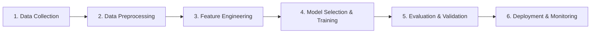

# Week 4 - Classical Machine Learning Pipeline & Theory

**Student Name:** Ali Muhammad Younis (886)  
**Course:** Artificial Intelligence, Machine Learning & Deep Learning  
**Week:** 4  

---

## 1. Machine Learning Taxonomy
Machine Learning is broadly categorized into:
1. **Supervised Learning**:
   - The algorithm learns from labeled training data $(X, y)$.
   - **Regression**: Continuous output prediction (e.g. house prices, stock values).
   - **Classification**: Discrete categorical output (e.g. spam detection, disease diagnosis).
2. **Unsupervised Learning**:
   - The model discovers hidden patterns or clusters in unlabeled data $(X)$.
   - Examples: K-Means Clustering, PCA (Principal Component Analysis).
3. **Reinforcement Learning (RL)**:
   - An agent learns through trial and error by interacting with an environment, receiving rewards or penalties.

---

## 2. Classical Machine Learning Pipeline

### Steps in Detail:
1. **Data Collection & Ingestion**:
   - Gathering structured tabular data (CSV, SQL databases) or unstructured data (images, text, audio).
2. **Data Preprocessing & Cleaning**:
   - Imputing missing values (`NaN`), removing duplicates, handling outliers, parsing dates.
3. **Feature Engineering & Transformation**:
   - Feature scaling (Standardization, Normalization), one-hot encoding for categorical variables, binning.
4. **Model Selection & Optimization**:
   - Choosing suitable hypothesis function (Linear, Polynomial, Logistic, Trees).
   - Minimizing cost function $J(\theta)$ using Gradient Descent or closed-form Normal Equations.
5. **Testing & Model Evaluation**:
   - Train/Test Split (e.g. 80/20), Cross-Validation.
   - Metrics: MSE, RMSE, MAE, R², Accuracy, Precision, Recall, F1-Score, ROC-AUC.
6. **Deployment & Serving**:
   - Exporting model artifacts (`pickle`, `joblib`, ONNX), serving via REST API (FastAPI / Flask).

---

## 3. Mathematical Foundations of Univariate Linear Regression

- **Hypothesis Function:**
  $$h_\theta(x) = \theta_0 + \theta_1 x$$
- **Mean Squared Error (MSE) Cost Function:**
  $$J(\theta_0, \theta_1) = \frac{1}{2m} \sum_{i=1}^{m} \left( h_\theta(x^{(i)}) - y^{(i)} \right)^2$$
- **Gradient Descent Parameter Updates:**
  $$\theta_0 := \theta_0 - \alpha \frac{1}{m} \sum_{i=1}^{m} (h_\theta(x^{(i)}) - y^{(i)})$$
  $$\theta_1 := \theta_1 - \alpha \frac{1}{m} \sum_{i=1}^{m} (h_\theta(x^{(i)}) - y^{(i)}) \cdot x^{(i)}$$
